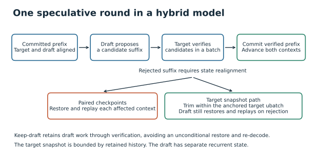
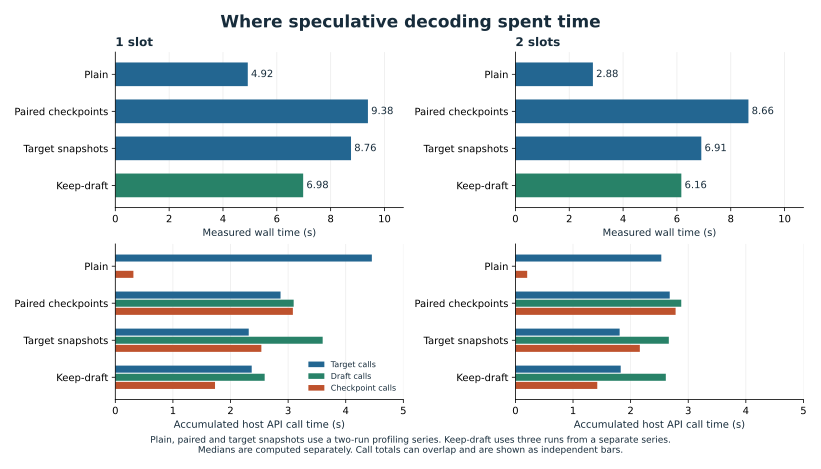
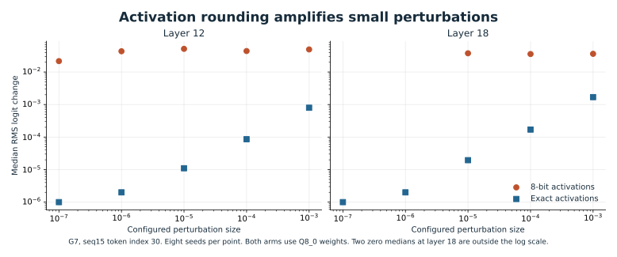

# Why Speculative Decoding Made Qwen3.5 Slower in llama.cpp — and How I Verified the Fixes

Draft-model speculation made decoding slower on a GTX 1650 with a Qwen3.5-2B Q8_0 target and Qwen3.5-0.8B Q4_K_M draft. The original CUDA trace showed substantial recurrent-state checkpoint traffic. Two experimental changes reduced that overhead. Even with both changes enabled, drafting cost more than verification saved on the target. Plain decoding remained fastest for this model pair on the ordinary workload.

The correctness investigation also exposed a testing problem. Changing how tokens were grouped into microbatches could change a greedy result even in plain decoding. A controlled CPU reference path gave a bit-exact oracle for the rollback logic on the tested fixtures.

## Benchmark

| Mode, draft maximum 3 where applicable | One slot, wall s | One slot, tok/s | Two slots, wall s | Two slots, tok/s |
|---|---:|---:|---:|---:|
| Plain | 4.94 | 58.3 | 2.88 | 99.9 |
| Paired checkpoints | 9.38 | 30.7 | 8.66 | 33.3 |
| Target checkpoint-free | 8.83 | 32.6 | 6.73 | 42.8 |
| Target checkpoint-free + keep-draft | 6.98 | 41.3 | 6.16 | 46.7 |

Six ordinary prompts, 48 generated tokens each, greedy, prompt cache disabled. Throughput is aggregate across slots and uses 288 tokens divided by median client wall time. The paired row comes from a separate two-repeat profiling series. The other rows come from a three-repeat series. For the checkpoint intervention, use the dedicated interleaved comparison. The measured two-slot median went from 8.08 to 6.84 seconds across five runs per arm, a 15.3% reduction, with all paired runs in the 34-restore mode. v1.1.0 traced the paired server's 34- and 39-restore modes to its target snapshot capacity (0 and 3). Capacity 3 is unused by paired checkpointing and slows it. Like-for-like reruns with the paired baseline at capacity 0 measured 13.9% (CUDA 13.2) and 16.2% (CUDA 13.1). With capacity 3, as in the independent rerun's 20.4%, the figures were 18.3–20.6%. [v1.1.0 interleaved results](results/v1.1/interleaved-matrix.csv) [Wall-time rows](results/draft-sweep.csv) · [Profiling series](results/profile-components.csv) · [Interleaved control](results/interleaved-summary.json)

## From the slowdown to the rollback abort

[Issue #32776](https://github.com/ggml-org/llama.cpp/issues/32776) reported a slowdown with larger Qwen3.5 models on different GPUs. The local historical reproduction used llama.cpp `418fe97b5`. Five warmed requests per mode gave median server generation rates of 64.76 tok/s for plain decoding and 30.02 tok/s for speculation, accepting 90 of 139 proposals on each speculative request. One labeled speculative trace captured 185 state save or restore calls and 3.737 GB of correlated GPU copies. The trace establishes that checkpoint work was substantial. Its ranges can overlap GPU activity and cannot be read as recoverable latency. [Historical requests](results/bench_baseline.json) · [Draft requests](results/bench_spec.json) · [Checkpoint trace](provenance/historical-trace.tsv)

The prototype study used `787a5612fceef602503e5f0ee6133cdc9b8a85c1`. Qwen3.5 uses recurrent state alongside attention state. Once recurrence has advanced through a rejected suffix, removing attention positions alone cannot restore the earlier recurrent state. The server must restore a checkpoint and replay the committed inputs, or select a retained snapshot within the supported rollback window.

The initial target-only rollback probe exposed a coupling in the server. At position 59, the common trim reached the draft context and asked it to roll back one token. The draft had zero recurrent snapshots. The operation was refused and the server aborted. The paired-checkpoint correction keeps target checkpointing active when the draft can only recover through its checkpoint. Both contexts can then restore and replay through the common rejection path. [Abort record](provenance/abort.txt) · [Paired patch](patches/paired-checkpoint.patch)

## Two ways to remove redundant work

The target checkpoint-free prototype makes realignment explicit per context. With bounded target capacity and an accepted anchor in the last microbatch, the target can select a recurrent snapshot. The draft still restores its own checkpoint and re-decodes the anchor and accepted inputs on rejection. Larger target drafts fall back to checkpointing. The prototype returns an error if snapshot rollback fails. The library fixture verified depths one through three, including repeated rejection, and verified refusal at depth four with capacity three. Target snapshots trade checkpoint traffic for recurrent memory. [CPU fixture](results/e8-target-cpu.csv) · [CUDA fixture](results/e8-target-cuda.csv) · [Prototype patch](patches/target-checkpoint-free.patch)

Keep-draft retains usable proposal work through target verification, avoiding an unconditional draft restore and re-decode. The later three-repeat series measured wall-time reductions of about 21% with one slot and 8% with two relative to the target-only optimization. Across tested draft maxima of 1, 2, 3, 5 and 8, draft call time exceeded the target call time saved. At one slot and draft maximum 3, target calls fell from 4,483 to 2,368 ms, while draft calls added 2,593 ms. These are accumulated host API durations. The 6.98-second wall measurement is a separate quantity. [Draft sweep](results/draft-sweep.csv) · [Keep-draft patch](patches/keep-draft.patch)

## Separating numerical variation from state corruption

The first two-slot greedy discrepancy could be reproduced by changing prefill grouping with capacity held fixed. Fixed-token replay then reproduced grouping-dependent logits with one sequence and no draft or rollback. Repeated results were deterministic in those fixtures. A small logit margin can turn a numerical change into a different argmax, after which comparing whole generated sequences mixes the original change with the consequences of different prefixes.

An early long-prompt test used zero GPU layers and assumed that meant CPU-only. Backend traces showed a 348-token matrix multiply on CUDA while the one-token path stayed on CPU. The corrected comparison hid CUDA and disabled operation offload. With reference CPU kernels, whole-prompt and 64-token shapes matched the single-token reference at all 384 fixture-position comparisons per configuration. With default CPU kernels, the maximum logit difference reached 2.98 and top choice changed in two comparisons. The result describes batch-shape sensitivity in this fixture, an existing numerical reproducibility problem. The particular CUDA kernels responsible for the original shape discrepancy remain unresolved. [Reference results](results/g11-summary.csv) · [Default CPU results](results/g12-default.csv)

The activation experiment retained Q8_0 weights and changed activation handling. In the single-token perturbation sweep, the quantized path amplified small injected deviations. At token index 30, layer 12, a configured perturbation of 1e-6 gave median RMS logit shifts of 0.0434 with activation rounding and 0.000002 with exact activations. This intervention supports activation rounding as an amplifier. It does not identify the first differing instruction in the original run. [Sweep data](results/perturbation.csv)

## Correctness and its limits

The CPU oracle forced reference kernels and hid CUDA. Plain one-slot, two-slot, and repeat controls agreed. Four draft-model modes and three n-gram modes each matched all six plain greedy token sequences at one and two slots, with 240 generated tokens per run. Rollback counters confirmed rejection paths in the draft-model runs. Deliberately skipping alternate partial trims produced two incorrect paired outputs and explicit server errors in the target-snapshot and n-gram snapshot modes. The same trim mutation hit no-op calls for checkpointed n-gram. Separately skipping alternate checkpoint restores aborted all four tested modes. These controls show that the harness can expose state errors through token differences or runtime failures. [Oracle report](provenance/oracle.txt) · [Trim mutation](provenance/mutation-trim.txt) · [Restore mutation](provenance/mutation-restore.txt)

Follow-up CPU controls checked keep-draft flag-off at one and two slots. The run with both flags absent covered one slot. With caching enabled, keep-draft matched plain on 9/9 one-slot requests and 6/6 in the corrected two-slot run. The 124-token prompt re-evaluated four tokens on repetition. At temperature 0.8, top-k 40, top-p 0.95 and seed 7, keep-draft on and off matched on 6/6 prompts at each slot count. A sampled plain repeat matched and three sampled outputs differed from greedy. This covers one seed and sampler configuration. Separately, the CUDA target prototype with its flag off matched paired output in all 12 archived two-slot runs, within each of the serial and concurrent schedules. An independent rerun matched in 33 of 34 two-slot runs, including 22 concurrent runs with forced admission delays and 35 to 39 checkpoint restores. One concurrent flag-off run differed on one of six prompts from generated-token index 2. v1.1.0 showed that this output is a reproducible consequence of admitting prompt 1 before prompt 0, and that paired builds produce it too. Across 198 further concurrent runs, flag-off and paired output were identical in every capacity and admission condition. [Keep-draft controls](provenance/keep-checks.txt) · [Cache rerun](provenance/cache-rerun.txt) · [CUDA flag-off](provenance/target-flag-off.txt) · [Flag-off rerun](results/rerun-flag-off.csv) · [Admission control](results/admission-control.csv)

## When n-gram lookup paid off

On six repetitive prompts with 96 generated tokens each, the best one-slot n-gram configuration reached 55.8 tok/s versus 44.4 for plain. The best two-slot setting reached 60.9 versus 63.7. On the ordinary 48-token workload, the fastest one-slot n-gram configuration made zero proposals, and the fastest two-slot configuration was slower than plain. Longer repetitive prompts also broke the earlier 0.5-logit comparison threshold. Two differently batched references disagreed on which outputs to flag. The short reference-kernel oracle and the longer throughput experiment support different conclusions. [N-gram results](results/ngram.csv) · [Long-prompt oracle](results/ngram-oracle.csv)

The rollback patches are research prototypes for the pinned revision. [PR #32832](https://github.com/ggml-org/llama.cpp/pull/32832) separately adds CUDA F16-to-F32 `SET_ROWS` support and addresses RoPE fusion. It has a different scope from these rollback changes. The original profiling comment and prototype follow-up document the separate rollback investigation. [Profiling comment](https://github.com/ggml-org/llama.cpp/issues/32776#issuecomment-7084326461) · [Prototype follow-up](https://github.com/ggml-org/llama.cpp/issues/32776#issuecomment-7123545377)

## Independent reproduction

A clean rerun on 24 November 2026 rebuilt every variant from the pinned sources on the same GPU with CUDA 13.2.86. The CPU oracle, follow-up, mutation and numerical comparisons, the E8 and E9 rollback fixtures and the serial flag-off control reproduced the archived records exactly. Draft-sweep throughput fell within −4.5% to +1.3% of the archive, with plain decoding fastest at both slot counts. The historical server measured 64.88 and 31.65 tok/s, accepting 90 of 139 proposals on every speculative request. The n-gram series reproduced the archived proposal counts and conclusions, with the best repetitive one-slot configuration at 55.5 versus 44.0 tok/s. Concurrent two-slot CUDA runs produced token sequences and restore counts that differed from the archive in both the paired and flag-off builds, while serial runs matched. [Rerun record](provenance/reproduction-2026-11-24.txt)

## What explained the concurrent differences (v1.1.0)

The toolkit did not. Fresh CUDA 13.1.115 builds reproduce the archived 13.1 device code instruction for instruction. Teacher-forced logits are bit-identical between 13.1 and 13.2 in all five batch shapes tested. The original archived 13.1 binaries, rerun today, produce the 13.2 rerun's tokens.

The cause was a harness setting. In the archived flag-off control and the paired arm of the interleaved series, the target ran with recurrent snapshot capacity 0. In the rerun, the same servers ran at capacity 3. At the pin, nonzero capacity changes how the hybrid memory splits a two-sequence decode into microbatches. That changes the matrix shapes and, at near-tied logits, the greedy tokens. Single-sequence decoding is unaffected, which is why serial runs always matched. With the capacity shim replaced by a no-op, every build, including CUDA 13.2, reproduces the archive exactly: the same tokens and 34 restores in all 18 concurrent runs across the three builds. The rerun's one unexplained run comes from admission order. When prompt 1 is admitted at least 15 ms before prompt 0, a different but stable output appears for each capacity, in 78 of 78 such runs. [v1.1.0 findings](provenance/v1.1/FINDINGS.md) · [Flag-off matrix](results/v1.1/flagoff-matrix.csv) · [Reverse admission](results/v1.1/reverse-admission-matrix.csv) · [Logit comparisons](results/v1.1/logit-toolkit-and-shape.csv) · [Efficiency retrospective](provenance/v1.1/efficiency-retrospective.md)

See [reproduction](REPRODUCE.md) and [methodology and limits](METHODOLOGY.md) for details.

Investigation and implementation developed with AI assistance. Experimental results were reproduced and reviewed by the author.
